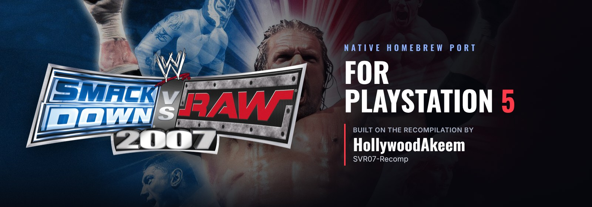
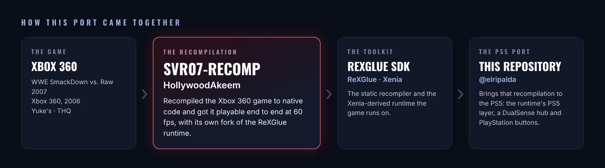

<p align="center">
  
</p>

<p align="center">
  <a href="../../releases/latest"></a>
  
  <a href="https://github.com/HollywoodAkeem/SVR07-Recomp"></a>
  <a href="https://discord.gg/GgDE5Vynyu"></a>
</p>

<p align="center">
  <b>WWE SmackDown vs. Raw 2007</b> running natively on a jailbroken PS5,<br>
  a port of <a href="https://github.com/HollywoodAkeem/SVR07-Recomp"><b>HollywoodAkeem's SVR07-Recomp</b></a>.
</p>

<p align="center">
  <a href="../../releases/latest"><b>Download</b></a> ·
  <a href="#install">Install</a> ·
  <a href="#controls">Controls</a> ·
  <a href="#building-from-source">Build from source</a> ·
  <a href="#credits">Credits</a>
</p>

---

<p align="center">
  
</p>

> [!NOTE]
> **This is a port of someone else's project.** The recompilation of SmackDown vs. Raw 2007, and getting the game playable end to end at 60 fps, are the work of **[HollywoodAkeem](https://github.com/HollywoodAkeem)**, with **[JoelUrena](https://github.com/JoelUrena)**, and [SVR07-Recomp](https://github.com/HollywoodAkeem/SVR07-Recomp), whose code and history are the base of this repository. This repository adds what the PS5 needs to run it (in [`ps5/`](ps5)): the runtime's PS5 layer, a hub made for the DualSense, and PlayStation button pictures. If you enjoy it, go give the original project a ⭐.

## What it is

A PS5 homebrew app (title ID `PPSA92007`) that runs SmackDown vs. Raw 2007 as native code. It isn't an emulator: the Xbox 360 game is statically recompiled with the [ReXGlue SDK](https://github.com/rexglue/rexglue-sdk), as SVR07-Recomp does on Windows, and runs on ReXGlue's PS5 platform layer, drawing with Vulkan (Mesa RADV).

It opens on its own **hub**, where you change settings and manage saves with the controller, then start the game.

> [!IMPORTANT]
> **No game files are included.** You need your **own Xbox 360 copy** of SmackDown vs. Raw 2007 as a disc image (`.iso`). It must be the **USA/Canada** release, the one this build was made for.

## Features

- **Up to 4K**: Rendering Quality at 720p (the console's), 1440p or 4K, with FXAA, anisotropic filtering and VSync.
- **The hub**: Home, Settings, Saves and About pages, driven by the DualSense, with menu music (a random song each time, **R3** for the next).
- **PlayStation buttons**: the game's Xbox button pictures are swapped for PlayStation ones in menus, help bars, match prompts and the HUD.
- **Save backups**: back up and restore your saves from the hub.
- **An on-screen keyboard** in the hub's style for names.

## Install

You need a jailbroken PS5 that runs homebrew apps from `/data/homebrew/`, with a homebrew launcher that lists them.

**With the app store:** install SmackDown vs. Raw 2007 and give it your disc image. It puts the app in `/data/homebrew/PPSA92007/` and the game in its `Assets/` folder. Start the app and press **START GAME**.

**By hand** (an FTP client and a tool that extracts Xbox 360 disc images, such as extract-xiso):

1. Download the latest `SvR2007-PS5` zip from [Releases](../../releases) and unzip it on your PC.
2. Over FTP, copy the `PPSA92007` folder into `/data/homebrew/`.
3. On your PC, extract your disc image (leave out `$SystemUpdate` and `nxeart`).
4. Over FTP, copy the extracted files into `/data/homebrew/PPSA92007/Assets/`, so you have `Assets/default.xex`, `Assets/pac/` and the rest of the disc.
5. Start **SmackDown vs. Raw 2007** from your homebrew launcher and press **START GAME**.

The first start shows a black screen for 10–30 seconds once, while the app makes PlayStation-button copies of the game's button pictures.

The download's `HOW TO INSTALL.txt` has the full instructions, the hub's controls and the folder layout.

## Controls

| DualSense | Xbox 360 |
|---|---|
| Cross / Circle / Square / Triangle | A / B / X / Y |
| L1 / R1 | LB / RB |
| L2 / R2 | LT / RT |
| L3 / R3 | stick clicks |
| Options | Start |
| Touchpad click | Back |

In the hub: **L1 / R1** change pages, **Cross** selects, **Circle** goes back, **Options** starts the game, **R3** changes the song.

## Menu music

Put your own songs (MP3, WAV, FLAC or OGG) in `/data/homebrew/PPSA92007/hub/music/`.

## Updating

Copy a newer `PPSA92007` folder over the old one. The game (`Assets`), your saves (`UserData`), backups and settings are kept.

## Known issues

- A few pictures still show Xbox buttons: the casket match prompt and the loading-screen tips.

## Reporting a problem

Report bugs on the **[RIPALDA Discord](https://discord.gg/GgDE5Vynyu)**. Send the newest file from `/data/homebrew/PPSA92007/logs/` (and `UserData/crashes/` if there is one), with what you were doing.

> [!TIP]
> ### 💙 Enjoying the port?
> If you've gotten some enjoyment out of this project, donations and love are always appreciated. Every bit helps keep these ports growing. Thank you!
>
> [](https://ko-fi.com/ripalda)

## Building from source

The repository's root is SVR07-Recomp as HollywoodAkeem made it (its Windows build; see [`README-SVR07-Recomp.md`](README-SVR07-Recomp.md)). The PS5 port is in [`ps5/`](ps5). The runtime's PS5 layer is on this repository's [`rexglue-ps5`](../../tree/rexglue-ps5) branch, and the PS5 toolchain file comes from the SvR 2011 PS5 port (`port/cmake/ps5-toolchain.cmake`).

1. Put your own `default.xex` in `ps5/assets/` and run `rexglue codegen svr07_manifest.toml` in `ps5/`.
2. Configure and build:
   ```sh
   cmake -S ps5 -B ps5/out/ps5 -G Ninja -DCMAKE_BUILD_TYPE=Release \
     -DCMAKE_TOOLCHAIN_FILE=<svr2011-ps5>/port/cmake/ps5-toolchain.cmake \
     -DPS5_PAYLOAD_SDK=<ps5-payload-sdk> -DREXSDK_DIR=<rexglue-ps5 checkout>
   ninja -C ps5/out/ps5 svr07
   ```
3. Link and package it as an app folder with `ps5/tools/ps5_package.sh ps5/out/ps5 <ps5-plume-triangle checkout>`. The hub's pictures go in `ps5/art/local/hub/` (as in the release's `hub/` folder) and aren't in the repository.

## Credits

- **[HollywoodAkeem](https://github.com/HollywoodAkeem)**: [SVR07-Recomp](https://github.com/HollywoodAkeem/SVR07-Recomp), the recompilation this port is built on, and its ReXGlue runtime fork ([rexglue-sdk-yukes](https://github.com/HollywoodAkeem/rexglue-sdk-yukes)).
- **[JoelUrena](https://github.com/JoelUrena)**: SVR07-Recomp contributor, including its v1.0 launch polish.
- **[KaikoClanworth1](https://github.com/KaikoClanworth1)**: the [SmackDown vs. Raw 2011 PC port](https://github.com/KaikoClanworth1/wwe-svr2011-pc), whose launcher the hub is modeled on.
- **[ReXGlue](https://github.com/rexglue/rexglue-sdk)**: the static recompiler and runtime.
- **[Xenia](https://xenia.jp)**: the Xbox 360 emulator the runtime's code comes from.
- **PS5 tooling**: the PS5 Payload SDK; Nazky's ps5-plume-triangle / UnleashedRecomp-Prospero and mihawk-99's RADV link recipe; Mesa RADV.
- **Libraries**: Dear ImGui, stb_image, stb_vorbis, dr_mp3, dr_flac; Oswald and Inter fonts (SIL Open Font License).
- **[@elripalda](https://github.com/elripalda)**: the PS5 port and its hub. Developed with [Claude Code](https://claude.com/claude-code).

## Disclaimer

An unofficial fan project, not affiliated with or endorsed by WWE, THQ, Yuke's, Microsoft or Sony. WWE SmackDown vs. Raw 2007 and all related names and art belong to their owners. This repository and its releases contain no game files: you need your own copy of the game. SVR07-Recomp's code is under its [BSD 3-Clause License](LICENSE).
